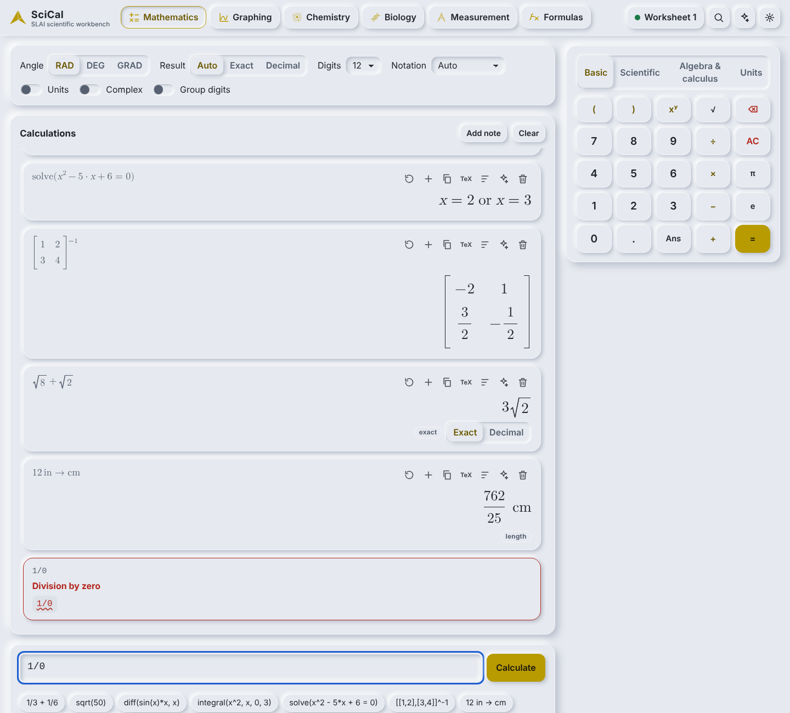

# SciCal

A scientific calculator and STEM workbench that runs on your own computer, part of SLAI v2.4.

* **Mathematics** – exact-first arithmetic, algebra, calculus, linear algebra, statistics, units, complex numbers.
* **Graphing** – interactive 2D plots (functions, implicit curves, inequalities, parametric, polar, sequences, vector fields, scatter with fits, histograms), sliders, roots/extrema/integrals/intersections/tangents.
* **3D graphing** – surfaces z = f(x, y), parametric surfaces, space curves and point sets that you can rotate, pan and zoom; sliders, layers, colour by height, transparent PNG export.
* **Save as SGEO / SDRW** – a 3D scene becomes an SGEO model (or a clearly labelled, lossy SDRW wireframe or contour drawing); a 2D graph becomes an SDRW drawing. Files are written by SLAI's own writers, validated and re-opened.
* **Finance** – 24 calculators (interest, loans and amortisation, annuities, NPV/IRR, break-even, supply and demand, growth, sensitivity tables…), each with its formula, assumptions and a working you can check.
* **Constants** – 85 physical constants (CODATA 2022 where applicable) with sources and uncertainties, insertable into any calculation.
* **STEM Lab and STEM checks** – SLAI's STEM agent solves differential equations (Euler, RK4, adaptive RK45), propagates uncertainty by Monte-Carlo, compares quadrature rules, reports conditioning, interpolates and bootstraps; and a shield button on a result has the agent compute it again by a different route and say whether it agrees. SciCal's value is always the one shown.
* **Chemistry, Biology, Measurement, Formulas** – calculators for each subject, each showing its working.
* **Worksheets** – every calculation is kept in a worksheet you can search, re-open and export (Markdown, text, CSV, JSON, and SLDC when SLAI is present).
* **Smooth 3D** – views glide to the preset you choose, a flick keeps turning and slows down, a *Spin* button turns the scene slowly, and a slider can be played back and forth. *Reduce motion* (Settings, or the system setting) switches all of it off.
* **Atoms, molecules and DNA in 3D** – every element shows its protons and neutrons as touching spheres in the nucleus, each electron on its own orbit in its own plane; DNA and RNA are drawn as two backbones joined by cylinder bases.
* **A Windows program and Android and iOS apps** (Tauri 2) – see [docs/MOBILE_AND_DESKTOP.md](docs/MOBILE_AND_DESKTOP.md) for how to build them on your own computers.
* Light, dark and high-contrast themes. Nothing is sent over the internet.



## Run it

```
pip install -r requirements.txt          # sympy, mpmath, numpy (Python 3.10 or newer)
python -m scical                         # from this folder; opens your browser
```

The STEM Lab and STEM checks use SLAI's STEM agent, which also needs `scipy` (and `colorama` 0.4.6 or newer on Windows) in the same Python environment: `pip install scipy colorama`. Without them SciCal works as before and the STEM pages say what is missing.

`python run_scical.py` does the same. The web client is shipped prebuilt in `dist/`, so Node is only needed if you change `src/`. If you do, run `npm install` once (it installs TypeScript) and then `npm run build`; the build compiles into a scratch folder first and only replaces `dist/` when that succeeded, so a failed build can no longer leave you with a blank page.
SciCal listens on `127.0.0.1:8768` only and opens the page with a one-time access token.

| Option | Meaning |
| --- | --- |
| `--port 8768` | Port to listen on (Documaster uses 8766, Reader 8767). |
| `--host` | Loopback addresses only; anything else is refused. |
| `--data-dir` | Worksheets and preferences. Default `%LOCALAPPDATA%\SLAI\SciCal` (Windows) or `~/.local/share/slai/scical`. |
| `--output-dir` | Exports. Default `Documents\SLAI SciCal`. |
| `--slai-root` | Path to the SLAI checkout. Found automatically from this folder when possible. |
| `--assets-dir` | Folder with the SLAI icons. Default `applications/assets`. |
| `--agents auto\|none\|strict` | Optional SLAI assistant. `none` never calls an agent; `strict` refuses to answer without one. |
| `--workers N` | Calculation worker processes (default up to 4). |
| `--timeout S` | Seconds one calculation may run (default 30). |
| `--worker-mode auto\|process\|thread` | Calculations in worker processes (default where they exist) or in threads (phones). |
| `--port-fallback` | If the port is taken, use any free one. |
| `--ready-line`, `--exit-on-stdin-close` | For the desktop app: print one `SCICAL_READY {json}` line, and stop when the app's pipe closes. |
| `--no-browser` | Do not open a browser window. |
| `--token T` | Fixed access token (for tests; random otherwise). |
| `--client-dir` | Use a different build of the web client. |

## Where things are

```
scical/core/units          dimensions, exact unit conversion, constants with sources
scical/core/expressions    lexer, parser, AST, text and LaTeX printers (nothing is ever eval'd)
scical/core/numerical      evaluator, statistics, linear algebra, SymPy algebra/calculus (funcs_symbolic)
scical/core/graphing       sampling, analysis, regression, 3D sampling (space.py)
scical/domains             chemistry, biology, measurement, formulas, finance, constants, STEM Lab forms (stemdefs.py) and the form catalogue (forms.py)
scical/services            worksheets, exports, SGEO/SDRW export (spatial.py), figure records (figures.py), worker pool and cancellation
scical/integrations        optional links to SLAI (assistant, SLDC, STEM checks and STEM Lab: stem_bridge, stem_checks, stem_lab)
scical/server              loopback HTTP service, security checks, routes
src/client, src/core       TypeScript client (strict, no innerHTML) -> dist/
src-tauri/                 Tauri 2 app: Rust shell, Windows engine launcher, Android (Chaquopy) and iOS (embedded CPython) hosts
scical/embed.py            start the server inside another program (the phone apps)
tools/build_engine.py      freeze the engine for the Windows app
tests, tests_ts, tests_e2e Python, TypeScript and browser tests
docs/                      USER_GUIDE.md, REPORTS.md, screenshots/
```

## Tests

```
PYTHONPATH=. python -m unittest discover -s tests          # 412 engine, domain, finance, constants, 3D, export, server, thread-pool and launcher tests
PYTHONPATH=. python -m unittest discover -s tests_e2e      # 38 browser tests (needs Playwright + Chromium)
npm install && npm test && npm run typecheck               # 79 TypeScript tests, strict type check
npm run build                                              # rebuild dist/
```

The SGEO/SDRW export tests need the SLAI checkout and `jsonschema` 4 or newer (for strict validation); without them they are skipped, not passed.

See [docs/USER_GUIDE.md](docs/USER_GUIDE.md) for how to use it and [docs/REPORTS.md](docs/REPORTS.md) for the security model, integration status, test results and known limits.
