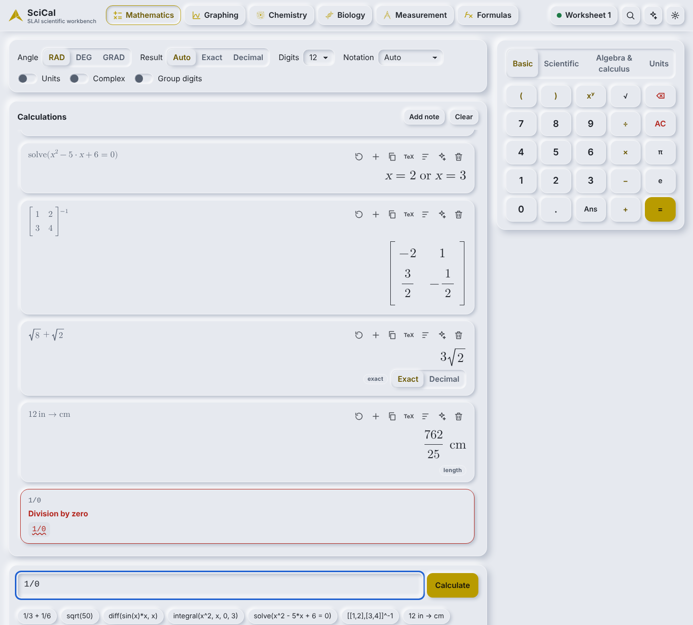
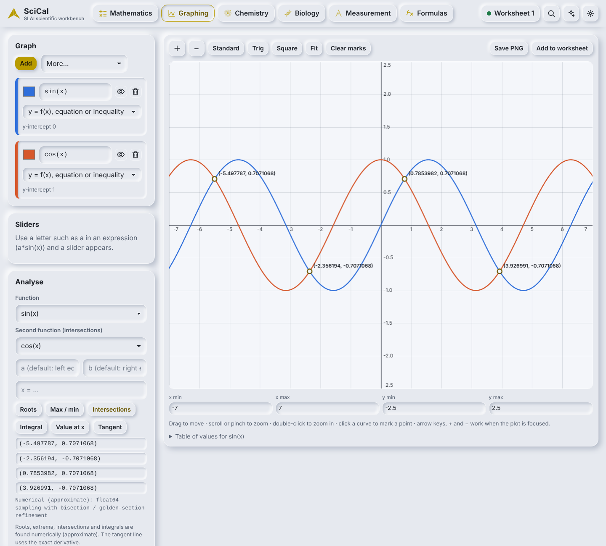
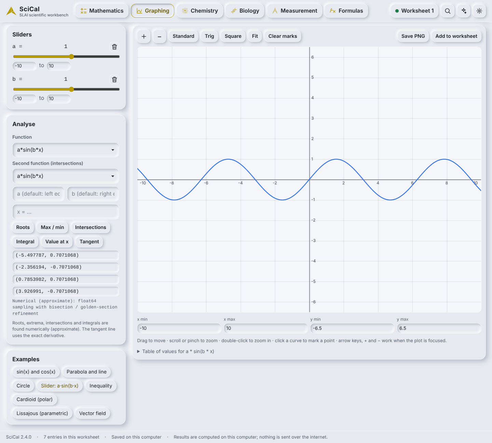
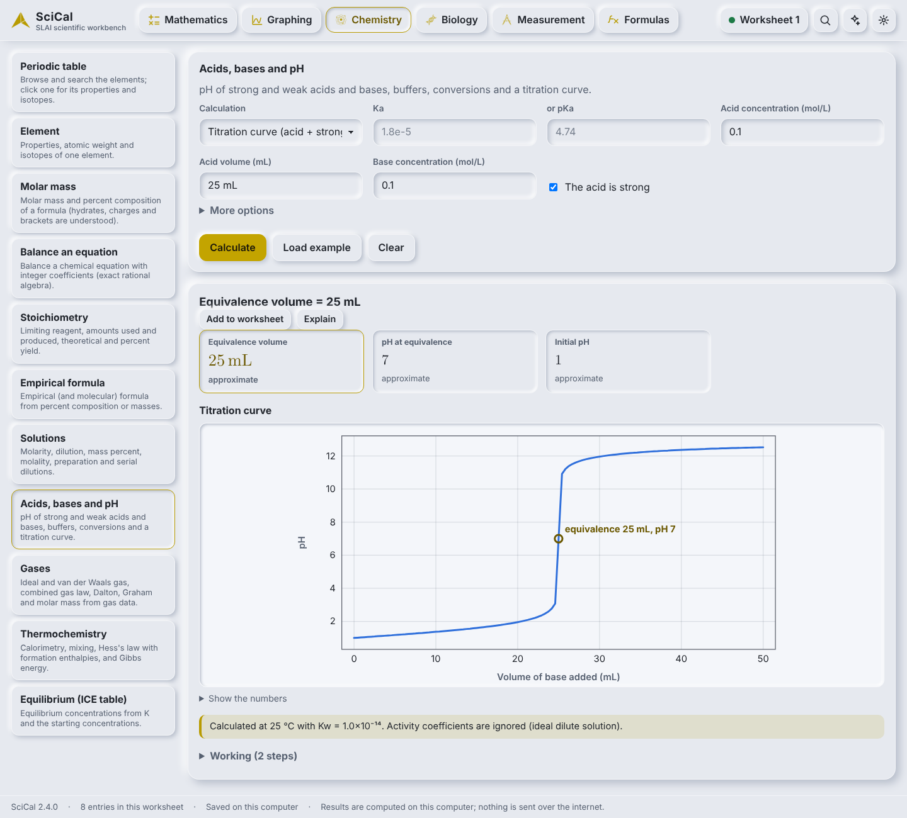
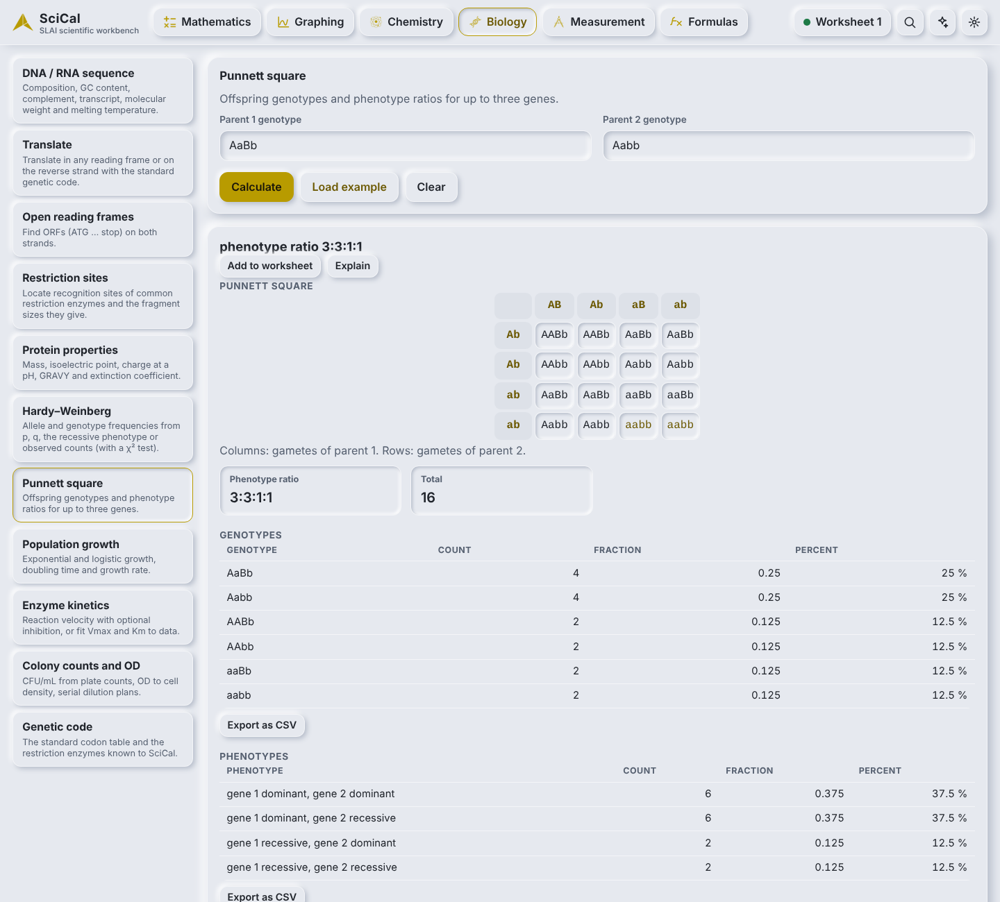
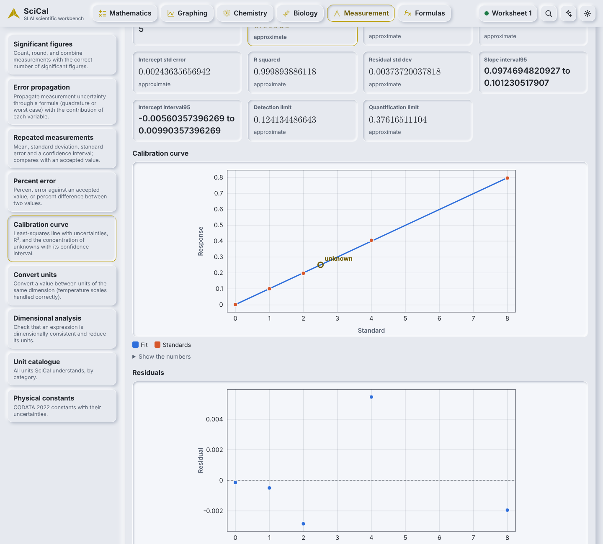
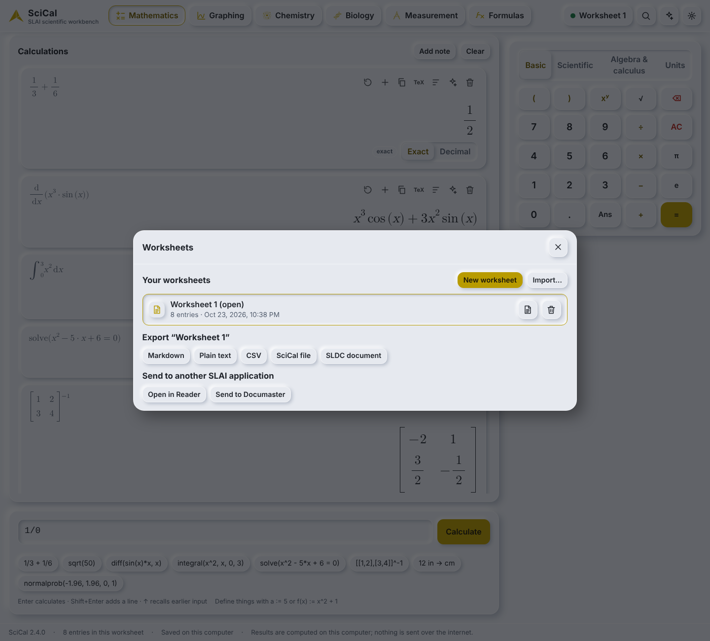
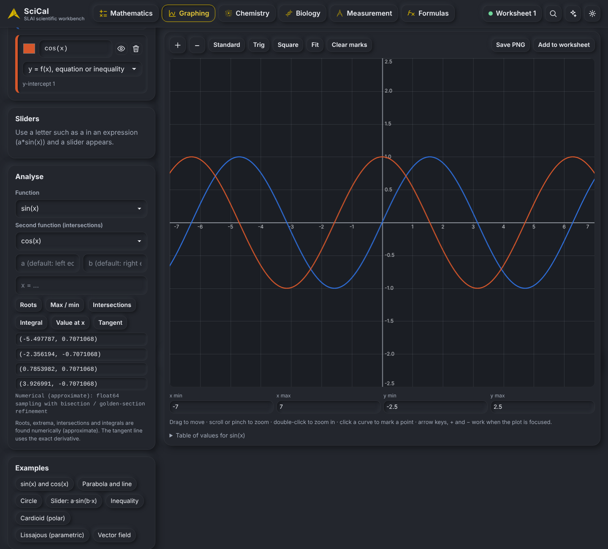
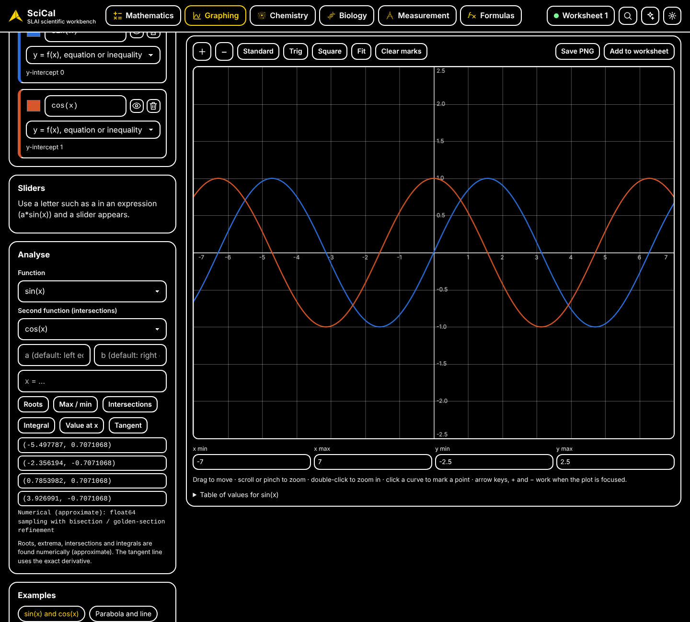
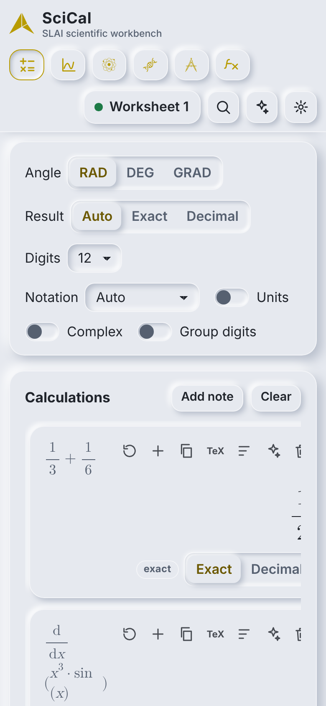

# SciCal user guide

## The window

Six workspaces along the top – **Mathematics, Graphing, Chemistry, Biology, Measurement, Formulas** – then your worksheet name, search, the SLAI assistant and settings. Arrow keys move between the tabs.
Everything you calculate is stored in the current **worksheet** and saved on this computer automatically (the dot beside the worksheet name shows the save state).

## Mathematics

Type in the box at the bottom and press **Enter** (Shift+Enter adds a line, ↑ recalls earlier input, Esc clears). The keypad has Basic, Scientific, Algebra & calculus and Units pages.

* **Exact first.** `1/3 + 1/6` is `1/2`, `sqrt(8)+sqrt(2)` is `3√2`. Results that are rounded say *approximate*; use **Exact / Decimal** on a card or the global Result switch to change the view.
* **Algebra and calculus:** `solve(x^2 - 5*x + 6 = 0)`, `diff(x^3*sin(x), x)`, `integral(x^2, x, 0, 3)`, `limit`, `taylor`, `factor`, `expand`, `simplify`, `nsolve`.
* **Linear algebra:** `[[1,2],[3,4]]^-1`, `det`, `eigenvals`, `rref`, `linsolve`.
* **Statistics:** `mean([1,2,3])`, `std`, `corr`, `normalcdf(x,mu,sigma)`, `normalprob(a,b,mu,sigma)`, `invnorm(p,mu,sigma)`, `binompdf(n,p,k)`, `tinterval`.
* **Units:** switch *Units* on, then `12 in -> cm`, `60 mph -> m/s`. Adding incompatible units is an error, not a guess.
* **Variables and functions:** `a := 5`, `f(x) := x^2 + 1`. Definitions apply to the lines after them in the worksheet and to the graphs.
* **Angles** are radians, degrees or gradians (Angle switch). **Complex** mode allows `sqrt(-4)`.
* Each card has buttons to re-run, add to a note, copy, copy as LaTeX, show the normalized input, **explain** (SLAI assistant) and delete. Errors say what is wrong and where (the offending part is underlined).

* **Plain English.** Type a sentence such as `convert 5 miles to km` or `molar mass of C6H12O6` and SciCal offers one or more proposals (calculator input or a workspace operation). It never calculates from the sentence itself – you pick a proposal and the exact engine runs it. This reader is rule-based and offline.

There are 143 built-in functions in 14 groups (arithmetic, number theory, trigonometry, hyperbolic, complex, vectors, matrices, statistics, distributions, algebra, calculus, control, constants, number bases). The keypad pages cover the common ones; the rest are typed by name.

## Graphing

Add layers (a function, a curve, data…). Each layer accepts what you would write on paper: `y = sin(x)`, `x^2 + y^2 = 4`, `y > x^2`, `x = 2`, parametric `(cos(t), sin(t))`, polar `r = 1 + cos(theta)`, sequences, vector fields, scatter data with a fit, histograms.

* Free letters become **sliders** (`a*sin(b*x)`), and definitions from the worksheet are available.
* Drag to pan, wheel or pinch to zoom, arrow keys to move, hover or focus to **trace**.
* **Analyse:** roots, extrema, integral between bounds, intersections of two layers, value at x, tangent at x. Numerical results are labelled approximate; the tangent is exact.
* **Table of values**, **PNG export**, and **Add to worksheet** (the layers and window are stored and can be re-opened).

## Chemistry

Periodic table with isotopes · molar mass and percent composition · equation balancing (exact) · stoichiometry with limiting reagent and yield · empirical formula · solutions and dilutions · pH, buffers and titration curves · gas laws · thermochemistry · ICE equilibrium tables.
Choose an operation on the left, fill in the form (or press **Load example**), then **Calculate**. Results show the numbers, the working steps and any assumptions (for example *25 °C, activity coefficients ignored*).
Charges on ions must be written unambiguously: `Cu^2+`, `NH4^+`. A bare `Cu2+` is refused with a hint, because it could mean two copper atoms.

## Biology

DNA/RNA sequence statistics, translation, open reading frames, restriction sites, protein properties, Hardy–Weinberg, Punnett squares, population growth, enzyme kinetics (Michaelis–Menten fit), colony counts and OD, and the standard genetic code.

## Measurement

Significant figures, error propagation (with the formula and each term's contribution), repeated measurements (mean, standard deviation, 95 % interval, with an experimental cross-check against the SLAI STEM agent when it is installed), percent error, calibration curves with an unknown, unit conversion, dimensional analysis, the unit catalogue and physical constants (each with its source and uncertainty).

## Formulas

A library of scientific formulas with variables, units and dimensions. **Solve for a variable** rearranges exactly and checks dimensions; **Analyse an equation** reports its dimensional consistency.

## Worksheets, search and export

Click the worksheet name to create, open, rename, delete, import and export worksheets. The search button looks through all of them. **Export** offers Markdown, plain text, CSV and JSON as downloads, and SLDC when SciCal can find a SLAI installation. In the SLDC file each calculation is stored as typeset equations (LaTeX), exactly as SciCal shows it, together with the text you typed, so Reader draws the formulas instead of showing `7*sqrt((5/8))`. **Send to another SLAI application** hands the worksheet to Reader or Documaster when they are running. Cells that start with `=`, `+`, `-` or `@` are neutralised in CSV so a spreadsheet cannot run them as formulas.

## 3D graphing

Graphing has a **2D | 3D** switch. In 3D, each layer is one of: a surface `z = f(x, y)` (type `sin(x)*cos(y)` or `z = x^2 - y^2`), a parametric surface `(x(u, v), y(u, v), z(u, v))`, a space curve `(x(t), y(t), z(t))`, or a set of points `x y z` (one per line).

* **Move:** drag to rotate, shift-drag or right-drag to move, scroll or pinch to zoom, double-click to reset; arrow keys, `+`, `-` and `0` work when the plot has focus. Click a point to mark it and read its coordinates.
* **Layers:** colour, opacity, wireframe, and colour by height; a letter that has no value (the `a` in `a*sin(x)*cos(y)`) becomes a slider.
* **Domain and sampling:** x and y ranges, up to 160 samples per axis, and an optional z window that cuts off very tall parts. Where a formula is not a real number (a pole, the square root of a negative) the surface is left open: it is shown as a gap and never bridged.
* **View:** perspective or orthographic, proportions (automatic keeps a sphere round; *fit to box* stretches; *equal scale*), axes, grid, legend, and Isometric/Top/Front/Side presets.
* **Save PNG** makes a picture with a transparent background. **Add to worksheet** keeps the scene (formulas, sliders, camera) and its picture, so SReader can show it with its formulas.

### Saving as SGEO or SDRW

Under the plot, **Save as** writes a file with SLAI's own writers, checks it with SLAI's validator and opens it again before reporting success. The dialog that follows says what is in the file, what was left out and why, and what to know.

| Button | You get | Is it the model? |
| --- | --- | --- |
| **SGEO model** (3D) | meshes for surfaces, curves for curves, points for points; each formula, domain and the sampling are stored beside the geometry, with a provenance claim | The sampled approximation of the formulas (float64), not the exact surface |
| **SDRW wireframe** (3D) | a 2D drawing of the grid lines from the current camera, orthographic, hidden lines not removed | No: derived and lossy, labelled as such in the drawing and its metadata |
| **SDRW contours** (3D) | a contour map of explicit surfaces `z = f(x, y)` | No: derived and lossy; other layer kinds are listed as left out |
| **SDRW drawing** (2D) | axes, grid and every curve as polylines, one drawing layer per graph layer, in the layer's colour | The curves as sampled for the current view |

SGEO stores no normals and no per-vertex colour, so a surface coloured by height is saved in its base colour (the z range is kept in its metadata). A graph has no unit of its own: the **unit** choice says what one graph unit is in the file. A saved file is never overwritten; a second save gets `-2`, `-3`, and so on. A copy is kept in the SciCal output folder as well as being downloaded.

## Finance

The Finance workspace has 24 calculators in groups: interest and rates, annuities and loans (with amortisation schedules and loan comparison), investment appraisal (NPV, IRR, discounted cash flow, payback, ROI, CAGR), inflation, percentage change, elasticity, break-even and profit, supply and demand (equilibrium, surpluses, tax incidence), growth and trend, and sensitivity tables. Each result shows its formula, the assumptions it made, the working, and exact values where they exist. **Open in Graphing** (on results that have a curve) carries the formula and its sliders into the Graphing workspace.

## Constants

The Constants page lists 85 physical constants with their symbol, value, uncertainty, unit and source (CODATA 2022 where it applies). Click one to insert it into a calculation, or convert it to another unit. There is one store of constants; Finance preferences are separate.

## Settings

Theme (follow the system, light, dark, high contrast), text size, reduce motion, angle unit, significant digits (6–100), notation (automatic, fixed, scientific, engineering) and digit grouping. Units mode and complex mode are switches above the calculation list. All are saved on this computer.

| Light | Dark | High contrast |
| --- | --- | --- |
|  |  |  |

## The SLAI assistant (optional)

The sparkle button shows which SLAI agents SciCal can reach. **Explain** on any result always gives a worked explanation built by SciCal itself; if you allow agents for the worksheet, an agent can add a plain-language version, after SLAI's Privacy agent has seen the text first. Agents never decide a number: every value comes from the deterministic engine. Agents are off per worksheet until you allow them, and off entirely with `--agents none`.

## Phone and narrow windows

The layout adapts; the keypad moves under the input.

